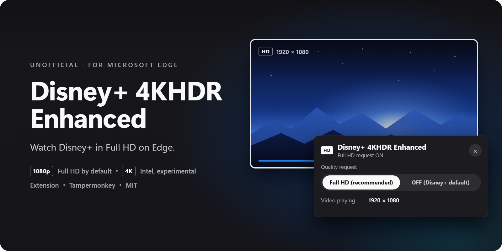

# Disney+ 4KHDR Enhanced

English | [日本語](README.ja.md)

| GPU & Connection Setup | Available Quality | When Using External Monitor |
| --- | --- | --- |
| Intel Integrated GPU (Render & Output) | 4K HDR | Use display port wired to Intel |
| NVIDIA / AMD dGPU | Up to Full HD (1080p SDR) | 4K/HDR is not recommended in this extension |
| Dual GPU (Intel + dGPU) | Depends on connected GPU | Verify physical port is wired to Intel |

> [!WARNING]
> **Freezes and BSODs have occurred during 4K/HDR playback (including 1080p HDR) on AMD configurations.**
> Use SDR (up to Full HD) on dGPUs, and do not repeat configurations that caused a freeze. Software timers in the extension cannot prevent OS or driver crashes.

An unofficial extension for Microsoft Edge on Windows that toggles Disney+ stream quality requests (Full HD / 4K for Intel). It does not include features such as DRM removal, key extraction, license spoofing, HDCP spoofing, or video downloading. A valid subscription and login are required.

Approximately 5 minutes of continuous 4K HDR playback was verified on a test machine with Intel Iris Xe, but operation is not guaranteed across all Intel products or all dGPUs. The limit for dGPUs reflects this extension's supported scope, not the hardware's inherent capability. For specific test measurements and validation history, see [docs/intel-4k.md](docs/intel-4k.md) (Japanese), [docs/diagnostics.md](docs/diagnostics.md) (Japanese), and [docs/related-issues.md](docs/related-issues.md) (Japanese).

> [!NOTE]
> **Disney+ player updates (October–November 2026):** v0.5.2 restored the Full HD mode on Disney+ player SDK 26.13, v0.5.3 fixed a startup guard that could still stop it with error code 83, and v0.5.4 supports SDK 26.14.2. The Intel 4K mode has not been re-verified on the new SDK yet and stops before playback.

## Prerequisites (Edge Settings)

These settings align the environment with the extension's operating requirements. They are not official Disney+ instructions. The availability of flags varies by Edge version, and changing them affects other services; keep track of the original values so you can revert them.

1. Set **PlayReady DRM** to **Enabled** in `edge://flags`.
2. Leave **Widevine DRM** at its default (**Enabled**). Since October 2026 Disney+ assigns Widevine (up to 720p) to Edge for normal playback, so disabling it makes playback with the extension OFF fail with error code 83. The Full HD mode selects PlayReady by itself.
3. Turn on **Use graphics acceleration when available** (hardware acceleration) under Edge Settings > "System and performance".
4. **Restart Edge**.
5. Verify that the **HEVC Video Extensions** are available on Windows.

## Installation & Updates

1. Download and extract the package from [Releases](https://github.com/ioridev/disney-plus-4khdr-enhanced/releases) or the source ZIP.
2. Open `edge://extensions` in Edge and enable **Developer mode**.
3. Click **Load unpacked** and select the extracted `extension` directory (the folder containing `manifest.json`).
4. Pin the extension to the toolbar, then reload the Disney+ page.

* Do not run this concurrently with other video quality scripts or extensions.
* When updating, overwrite the entire directory, click the reload button for this extension on `edge://extensions`, and reload the Disney+ tab.

## Usage

- **Left-click icon**: Toggles the Full HD request ON/OFF and reloads the active tab.
- **Initial state**: Until you toggle it for the first time, the extension starts with the Full HD request ON. Once you turn it OFF, it stays OFF. If Full HD playback fails, the next page load starts OFF.
- **Right-click icon**: Select "Start 4K (for Intel GPUs, this page only)" or "Show/Hide Settings Panel" (`Alt+Shift+4` can also toggle the panel).
- **Language**: The settings panel, toolbar tooltips and menu follow the browser language: Japanese for Japanese, English otherwise. The collapsed 開発者向け診断 (developer diagnostics) section stays in Japanese.
- **Settings panel**: Switch between "Full HD (recommended)" and "OFF (Disney+ default)", see the resolution of the video that is playing, and use "Copy diagnostics" for bug reports. Diagnostic modes and detailed logs are in the collapsed 開発者向け診断 (developer diagnostics) section.
- **4K mode behavior**: The 4K request is active for the current page only and reverts to OFF upon reload. The extension uses WebGL to detect the GPU, but this does not guarantee physical video output routing.

| Badge | State |
| --- | --- |
| OFF | Normal playback (unmodified) |
| HD | Requesting Full HD (does not guarantee actual playback resolution) |
| 4K | Requesting Intel 4K (active for this page only) |
| DBG | Diagnostic mode chosen under 開発者向け診断 (developer diagnostics) in the settings panel |
| ! | Error occurred (check the settings panel) |

The toolbar badge indicates the requested mode, not the actual playback quality. Check the actual resolution under 再生中の映像 (video playing) in the settings panel, and playback duration and frame progress under 開発者向け診断 (developer diagnostics).

Standard Full HD and Intel 4K modes do not have short timeout shutdown timers, nor do they perform automatic playback or automatic retry on errors. For details on diagnostic time-limited modes, see [docs/diagnostics.md](docs/diagnostics.md) (Japanese).

## Using an External Monitor in Dual-GPU Configurations

If the GPU rendering Edge differs from the GPU connected to the monitor, playback may fail due to output protection errors. On the test machine, playback failed when connected via the NVIDIA port, but succeeded when switching the same monitor to a port wired to the Intel GPU.

1. In Windows "Settings > System > Display > Graphics", set Edge's preferred GPU to the **Intel integrated GPU**, then restart Edge.
2. In "Advanced display settings", verify that the target monitor is connected to the Intel GPU. If it is connected to the dGPU, reconnect it to a port wired to Intel (connector types such as USB-C, HDMI, or Thunderbolt alone do not indicate internal routing, which is model-specific).
3. For HDR display output, enable Windows HDR on the target monitor beforehand (the extension does not modify this setting automatically).

## Development

Node.js is not required if you are only using the extension.

- Environment: Node.js 24 or later
- Run tests: `npm test`
- Build: `npm run build` / `npm run build:check`

If you modify the HLS selection or communication adapters under `src/`, run `npm run build` to regenerate the embedded code. For all other core modifications, edit `extension/DisneyPlus-Edge-Enhanced.user.js` directly.

## Issue Reporting & License

When reporting an issue, please include the versions of your OS, Edge, GPU, and graphics driver, along with the mode used, actual video dimensions, frame progress, and error details.

> [!IMPORTANT]
> Never post HAR files, cookies, credentials, full manifests, license responses, memory dumps, or other private raw logs to public issues.

- License: [MIT License](LICENSE)
- Third-party notices: [NOTICE.md](NOTICE.md)
- Privacy Policy: [PRIVACY.md](PRIVACY.md)
- Related documents: [docs/intel-4k.md](docs/intel-4k.md) (Japanese) / [docs/diagnostics.md](docs/diagnostics.md) (Japanese) / [docs/related-issues.md](docs/related-issues.md) (Japanese)
